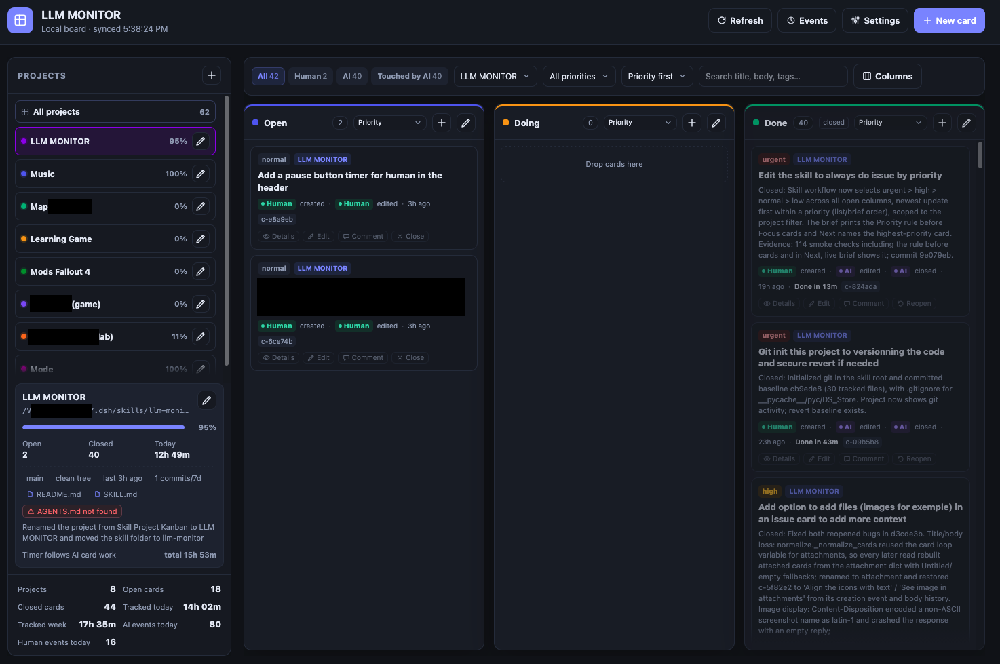

# LLM MONITOR

A local-first kanban board for open notes, tasks and project follow-up. It has a Python CLI for
agents, a tiny local web UI for humans, and a shared JSON store where every mutation is attributed
to **AI** or **human**.

The UI is English-only, dependency-free, light/dark themed, and runs on `127.0.0.1`. No account,
cloud service, database or package install is needed.



*Projects, custom columns, AI/human provenance and project activity on one local board.*

## Install

### LLM / agent — automatic install

An agent with filesystem access can install the skill from a checkout without a package manager.
Resolve the harness's skill root (the parent directory of its installed skills), copy only the
runtime files, and verify:

```bash
SKILL_ROOT="/absolute/path/to/harness/skills"   # the harness's skill directory
DEST="$SKILL_ROOT/llm-monitor"
mkdir -p "$DEST"
cp -R SKILL.md README.md kanban.py app ui tests "$DEST/"
python3 "$DEST/kanban.py" doctor
```

Keep the destination folder named `llm-monitor` so it matches the `name` in `SKILL.md`. Register or
refresh the harness catalog entry under that name; do not install a second copy or symlink. The data
home (`~/.kanban` by default) is outside the skill and is shared by every installation on the same
machine.

### Human — manual install

1. Clone or download this repository, then open a terminal in its root.
2. Create the skill directory and copy the runtime files (the same commands as the agent path above,
   replacing `SKILL_ROOT` with your harness's skills directory).
3. Run `python3 "$DEST/kanban.py" doctor` to confirm Python 3.9+ and the data home.
4. Initialize the board once, then start the local UI:

```bash
python3 "$DEST/kanban.py" init
python3 "$DEST/kanban.py" serve --daemon
python3 "$DEST/kanban.py" url
```

Open the printed `127.0.0.1` URL. No `pip install`, virtualenv, database or cloud account is
required; Git is optional and read-only for project activity.

### Publishing to GitHub

The repository is already Git-ready: `.gitignore` excludes Python caches, OS metadata, local board
data and server runtime files. Create an empty GitHub repository, then point this checkout at it and
push the current `main` branch:

```bash
git remote add origin git@github.com:<owner>/llm-monitor.git
git push -u origin main
```

Replace `<owner>` with the GitHub account or organization. Do not commit `~/.kanban` data, server
logs, attachments or credentials; they stay outside the repository.

## What it does

- **Cards** — create, edit, move, close, reopen, comment, delete; tags, priority, required project
  link, image/file attachments.
- **Completion time** — closed cards show elapsed time from creation to close on the board and in
  card details.
- **Custom columns** — add, rename, recolor, reorder, delete with card relocation; closed/open
  state defines what "closed" means; each column has its own sort control.
- **Provenance** — every card shows who created, last edited and closed it. Each mutation is in the
  card's history; a newest-first event audit trail records AI vs human activity in a topbar popup.
- **Filters** — All, Human (last editor), AI (last editor), Touched by AI (any provenance actor),
  project filter and search.
- **Projects** — register local projects by absolute path; drag rows to reorder; dashboard with
  automatic progress, git branch, last commit, dirty state, commits in the last 7 days.
- **Automatic progress** — closed cards divided by all cards, rounded to a whole percent and
  recalculated whenever a card is created, deleted, moved, closed, reopened or changes project, or
  a column's closed state changes. A CLI `--progress` edit is a temporary override; the next
  relevant mutation recalculates it.
- **Time tracking** — moving a card into the `Doing` column starts the project timer for that card
  (AI moves only); closing the card stops the matching timer. CLI `timer start/stop` remains
  available for manual sessions. No timer controls in the UI.
- **Agent brief** — compact context of priority-ordered open cards, projects, recent events and a
  next step that picks cards by priority, capped near a character budget.
- **Safe storage** — atomic saves, backup file, corruption recovery, advisory file lock, shared
  data home. CLI edits appear live in the UI through a server change watcher, not a timer poll.
- **Offline UI** — no remote scripts, fonts, styles or imports; icons are a local inline SVG set,
  not emoji. Light/dark theme, custom dropdowns and scroll shadows are implemented in local CSS/JS.

## Run it

Resolve the skill root (the directory containing this README and `kanban.py`):

```bash
SKILL_ROOT=/absolute/path/to/llm-monitor
KANBAN="$SKILL_ROOT/kanban.py"
python3 "$KANBAN" doctor
```

Initialize the default data home (`~/.kanban`), start the UI, and print its URL:

```bash
python3 "$KANBAN" init
python3 "$KANBAN" serve --daemon
python3 "$KANBAN" url
```

The default URL is `http://127.0.0.1:8787`; if the port is busy the server tries the next nine
ports, so always use `url` for the authoritative address. Stop with:

```bash
python3 "$KANBAN" serve --stop
```

Use `--home` before the subcommand, or set `$KANBAN_HOME`, to isolate a board:

```bash
python3 "$KANBAN" --home "$HOME/.kanban-test" serve --port 8899 --daemon
```

## CLI quick start

```bash
python3 "$KANBAN" brief
python3 "$KANBAN" add "Ship onboarding" --body "Acceptance criteria" --priority high \
  --project "/abs/path/to/app" --tags "ui,onboarding"
python3 "$KANBAN" list
python3 "$KANBAN" show c-fcc888
python3 "$KANBAN" edit c-fcc888 --body "Updated context" --note "Clarified scope"
python3 "$KANBAN" move c-fcc888 doing --note "Ready to implement"
python3 "$KANBAN" comment c-fcc888 --text "Tests pass on main"
python3 "$KANBAN" close c-fcc888 --note "Merged in commit abc123"
python3 "$KANBAN" reopen c-fcc888
```

Global `--json` (before the subcommand) emits machine-readable output:

```bash
python3 "$KANBAN" --json list
python3 "$KANBAN" --json status
```

## Provenance model

| Field | Meaning |
|---|---|
| `created_by` | Actor who created the card (`ai` or `human`) |
| `updated_by` | Actor of the last mutation |
| `closed_by` | Actor who closed it, if closed |
| card `history` | Timestamped mutations with actor, action, summary and field diff (capped 50) |
| global `events` | Newest-first audit trail across cards, columns, projects and timers (capped 500) |

The CLI defaults to `--actor ai`. API and UI mutations are always recorded as `human`. The UI badges
therefore distinguish AI-created/edited/closed work from human work, and the history shows exactly
what changed. Agents must not use `--actor human`, the HTTP API or UI automation to fake human
provenance.

## Web UI

Open the URL printed by `url`. The board supports:

- Drag cards between columns; dropping into a closed column closes the card. A card cannot be created
  without a registered project.
- Add/edit/close/reopen cards, comments, full details with history and comments, and image/file
  attachments from the details modal or while creating/editing a card (uploaded on save).
- Add/edit/reorder/delete columns and sort each column independently by priority, update, creation or
  name. Deleting a column with cards asks for a destination column.
- Register projects by absolute path, edit details and notes, drag rows to reorder the Projects list,
  and **Remove from registry** without deleting the folder or its cards. The left **Projects** menu is
  a compact list with an **All projects** row at the top; selecting a project filters the board to its
  cards, shows the project detail card below, tints the selected row with the project color and becomes
  the default project for new cards. The **All projects** row clears the filter.
- Project details probe the project's own docs (`README.md`, `AGENTS.md`, `SKILL.md`, `docs/`).
  Available docs show as pills; missing `README.md`/`AGENTS.md` show red warnings. The brief lists
  found/missing docs and tells agents to read them before working a project's card.
- The **Browse…** button beside *Absolute path* opens the host's native folder chooser (macOS Finder,
  Linux zenity/kdialog, Windows PowerShell); the local server supplies the absolute path because
  browsers cannot expose it. If no native chooser is available, type the path manually.
- Project progress is automatic; the detail card and row labels show it. The UI has no timer controls:
  AI card moves and closes drive the automatic timer. Git probes that cannot run show a red
  **git unavailable** badge with the full error on hover instead of fatal text.
- Filter and search; the view refreshes automatically when the data file changes (a long-poll watcher
  on `/api/watch`), on focus/visibility, and after UI mutations. No fixed refresh timer.
- The **Settings** topbar menu holds the light/dark theme toggle (showing the current theme) and the
  server status (`Server on`/`Server off` with a green/gray dot). Escape or an outside click closes it.
- Recent AI/human events live in the **Events** button in the topbar, not in the sidebar. All icons are
  local inline SVG; the UI contains no emoji or pictographic glyphs.
- Light/dark theme stored in `localStorage`; no remote assets, fonts or network imports.

The UI has no authentication. Keep it on loopback and do not expose it to a network.

## Projects and progress

```bash
python3 "$KANBAN" projects add "/abs/path/to/project" --name "Child Learning Game"
python3 "$KANBAN" projects list --git
python3 "$KANBAN" projects edit "Child Learning Game" --note "Core loop works"
python3 "$KANBAN" projects reorder "Music" "Child Learning Game"  # pass every project exactly once
python3 "$KANBAN" timer start "Child Learning Game" --note "Implementing scene 2"
python3 "$KANBAN" timer status
python3 "$KANBAN" timer stop
python3 "$KANBAN" activity --project "Child Learning Game"
```

Git probes are read-only. Progress is automatic (`closed cards / all cards`, rounded): the agent
must not invent a completion percentage. `projects edit --progress N` stores a temporary manual
override, but the next card/column mutation recalculates it. Removing a project detaches its cards
rather than deleting them; the project folder is never touched. The timer normally follows AI card
work: a move into `Doing` starts it for that card, closing the card stops the matching session.
`timer start/stop` is for manual CLI sessions.

## Columns

```bash
python3 "$KANBAN" columns list
python3 "$KANBAN" columns add "QA" --color "#f59e0b"
python3 "$KANBAN" columns edit qa --closed
python3 "$KANBAN" columns edit qa --open
python3 "$KANBAN" columns rm qa --move-to open
python3 "$KANBAN" columns reorder open doing done
```

Marking a column closed closes every card inside it. Deleting a non-empty column requires
`--move-to`. Closed columns are how cards are closed; moving a card out reopens it.

## Data home

Default `~/.kanban`, overridden by `$KANBAN_HOME` or `--home`:

- `data.json` — shared board data.
- `data.json.bak` — backup from the previous save.
- `data.corrupt-<stamp>.json` — preserved corrupt file if recovery happens.
- `server.json`, `server.log`, `kanban.lock`.

Saves use a temp file, fsync and atomic replace; mutations take an advisory lock where supported.
If `data.json` is corrupt, the store recovers from the backup and preserves the corrupt copy. Back up
the whole directory before bulk changes.

## Tests

```bash
cd "$SKILL_ROOT"
python3 tests/smoke.py
```

The stdlib smoke test uses a temporary data home and covers cards, provenance, columns, projects,
project docs discovery, timers, the brief, the API (including folder browse and the live change watcher),
corruption recovery and static UI serving. It does not touch the real board.

## Layout

```
SKILL.md              harness skill manifest and agent rules
README.md             this file
kanban.py             portable entrypoint
app/                  model, store, cards, projects, git/docs probes, brief, CLI, API/server
ui/                   static HTML/CSS/JS
tests/smoke.py        end-to-end smoke test
LICENSE               MIT license
```

The skill is portable: copy the whole directory into another harness's skill root; Python 3.9+
stdlib only. `kanban.py` adds its own directory to `sys.path`, so it does not depend on the harness
runtime. Do not install the same skill twice via a copy and a symlink.

## License

MIT — see [LICENSE](LICENSE). Copyright (c) 2026 Raphaël Bourgeat.
